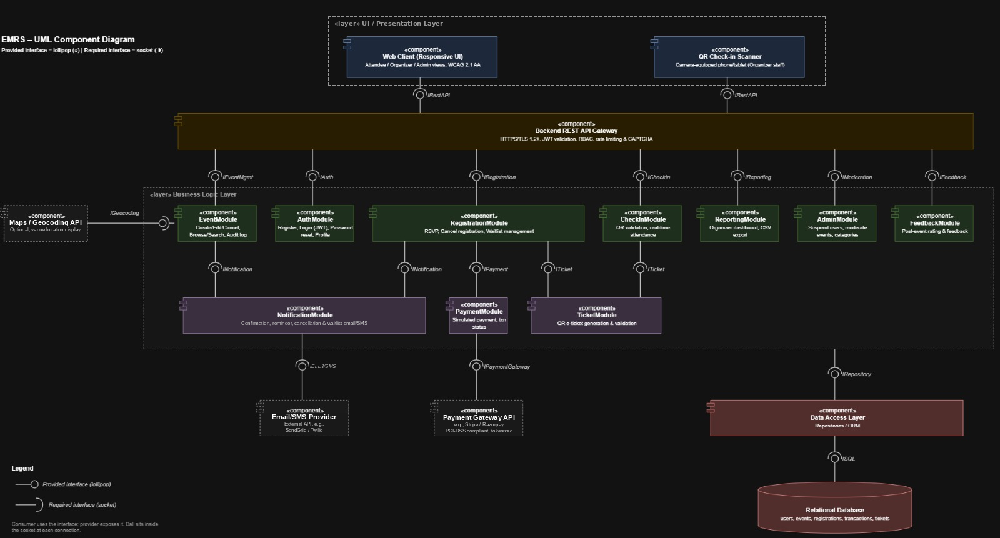

# Event_Management_Team7
An Event Management and Registration System (EMRS) featuring event creation, attendee discovery, RSVP registration, automated waitlisting, QR e-ticket issuance, and real-time admission check-in.

Project Manager - Aariz

Development Lead - Dhanraj Rathod

Product Owner - Vaishali Krishnan

Testing - Avinash Julakatti

**Link to jira space:** https://vaishaliam313.atlassian.net/jira/software/projects/EMT/summary

## Tech stack
- **Backend:** C++17 REST API ([cpp-httplib](https://github.com/yhirose/cpp-httplib), [nlohmann/json](https://github.com/nlohmann/json)), SQLite3
- **Security:** PBKDF2-HMAC-SHA256 password hashing (OpenSSL), bearer token sessions, parameterized SQL queries
- **Frontend:** Responsive HTML5 / CSS3 / JavaScript web client and QR check-in portal served by the backend (`web/`)
- **Tests:** GoogleTest unit and integration test suites, gcov/gcovr coverage, pytest + Playwright browser tests for the web client
- **CI/CD:** GitHub Actions (build, test, coverage, cppcheck, CodeQL security scan, Docker build and GHCR publish)

## Running the web client
```bash
cmake -S . -B build && cmake --build build -j
EMRS_DB=emrs.db EMRS_PORT=8080 EMRS_WEB_DIR=web ./build/emrs_server
# open http://localhost:8080
```

## Running the tests
```bash
ctest --test-dir build --output-on-failure      # C++ unit and API tests
pip install -r tests/frontend/requirements.txt  # one time
playwright install chromium                     # one time
pytest -v                                       # browser tests for web/
```

## Documentation
All software engineering specifications and architecture models are located in the [`docs/`](docs/) directory:
- [Software Requirements Specification (SRS)](docs/Software%20Requirements%20Specification%20(SRS).docx)
- [Software Architecture Document (SAD)](docs/EMRS_SAD_v1_1_UML_Aligned.pdf)
- [System Test Plan](docs/EMRS_Test_Plan_v1_1.pdf)
- [Sprint 1 Test Plan (EMT-20)](docs/Sprint_1_Test_Plan.md)
- [Branch Protection & CI Quality Gates (EMT-19)](docs/BRANCH_PROTECTION.md)
- [UML Component Diagram](docs/EMRS_component_diagram_updated.png)



## Repository Structure
```
Event_Management_Team7/
├── .github/
│   └── workflows/
│       ├── cd.yml                  # Publish Docker container to GHCR on main branch merge
│       ├── ci.yml                  # CI: build, unit tests, coverage, cppcheck, docker smoke test
│       └── codeql.yml              # CodeQL security static analysis
├── docs/                           # Project requirements, architecture specs, test plan & diagrams
│   ├── BRANCH_PROTECTION.md        # Branch protection rules & CI quality gate criteria
│   ├── EMRS_SAD_v1_1_UML_Aligned.pdf
│   ├── EMRS_Test_Plan_v1_1.pdf
│   ├── EMRS_component_diagram_updated.png
│   ├── Software Requirements Specification (SRS).docx
│   └── Sprint_1_Test_Plan.md       # Sprint 1 test plan (EMT-11, EMT-12, EMT-14)
├── src/                            # Modular C++17 backend source code
│   ├── api/                        # REST API routing & request handlers
│   │   ├── Routes.h
│   │   └── Routes.cpp
│   ├── auth/                       # Password hashing & cryptographic utilities
│   │   ├── PasswordHasher.h
│   │   └── PasswordHasher.cpp
│   ├── db/                         # Database connection & schema management
│   │   ├── Database.h
│   │   ├── Database.cpp
│   │   ├── Schema.h
│   │   └── Schema.cpp
│   ├── services/                   # Business logic layer
│   │   ├── AuthService.h
│   │   ├── AuthService.cpp
│   │   ├── EventService.h
│   │   ├── EventService.cpp
│   │   ├── RegistrationService.h
│   │   ├── RegistrationService.cpp
│   │   ├── TicketService.h
│   │   ├── TicketService.cpp
│   │   ├── UserService.h
│   │   └── UserService.cpp
│   ├── util/                       # Input validation & sanitization
│   │   ├── Validation.h
│   │   └── Validation.cpp
│   └── main.cpp                    # Application entry point & HTTP server
├── tests/                          # Automated GoogleTest test suites
│   ├── TestServer.h                # In-memory ephemeral test harness
│   ├── test_api_event.cpp          # Event creation API & authorization test suite
│   ├── test_api_login.cpp
│   ├── test_api_register.cpp
│   ├── test_auth_service.cpp
│   ├── test_database.cpp
│   ├── test_event_service.cpp
│   ├── test_health.cpp
│   ├── test_password_hasher.cpp
│   ├── test_registration_service.cpp
│   ├── test_ticket_service.cpp
│   └── test_validation.cpp
├── web/                            # Responsive presentation layer
│   ├── app.js                      # Client routing, RSVP, and ticket scanner
│   ├── index.html                  # Accessible UI (Attendee, Organizer, QR Check-in)
│   └── style.css                   # Modern dark-mode interface styling
├── .dockerignore
├── .gitignore
├── CMakeLists.txt
├── Dockerfile
└── README.md
```

## Build and run
```bash
cmake -S . -B build -DCMAKE_BUILD_TYPE=Debug
cmake --build build -j
ctest --test-dir build --output-on-failure
./build/emrs_server          # http://localhost:8080
```

Environment variables:
- `EMRS_PORT` (default `8080`)
- `EMRS_DB` (default `emrs.db`)
- `EMRS_WEB_DIR` (default `web`)

Docker:
```bash
docker build -t emrs . && docker run -p 8080:8080 emrs
```

## Workflow
1. Developer works on one feature branch per Jira story (e.g. `EMRS-1-user-registration`), one commit per story.
2. Pull request into `test`; CI must be green.
3. Tester verifies on `test`, then merges `test` into `main`.
4. Merge to `main` publishes the Docker image (CD).

Commit messages start with the Jira key, e.g. `EMRS-1: Add user registration and validation`.
