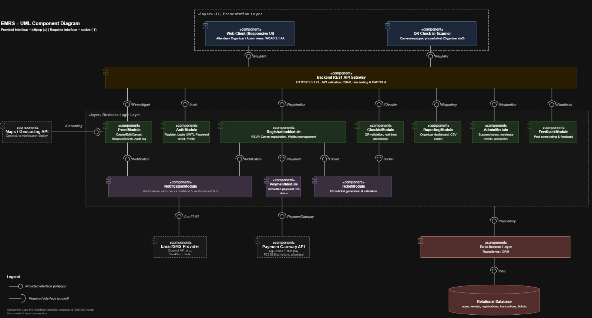

# Event_Management_Team7
An Event Management and Registration System (EMRS) featuring event creation, attendee discovery, RSVP registration, automated waitlisting, QR e-ticket issuance, and real-time admission check-in.

Project Manager - Aariz

Development Lead - Dhanraj Rathod

Product Owner - Vaishali Krishnan

Testing - Avinash Julakatti

**Link to jira space:** https://vaishaliam313.atlassian.net/jira/software/projects/EMT/summary

## Tech Stack
- **Backend:** Node.js & Express REST API, SQLite3 (`better-sqlite3`)
- **Frontend:** React.js (Vite) Single-Page Application (`frontend/`)
- **Security:** Salted bcrypt password hashing, JWT bearer tokens, parameterized SQL queries, security headers
- **Tests & Quality:** Node.js native test runner (`node:test`) with experimental coverage, ESLint 9+ flat configuration
- **CI/CD:** GitHub Actions (Node.js unit tests with coverage, ESLint static analysis, React production build, Docker container build and GHCR publish)

## Getting Started

### Prerequisites
- Node.js >= 20 (v22 recommended)
- npm >= 10

### Running the Application

1. **Install dependencies:**
   ```bash
   npm --prefix backend install
   npm --prefix frontend install
   npm install
   ```

2. **Seed Demo Data (EMT-49):**
   ```bash
   npm run seed
   ```

3. **Start Backend Server:**
   ```bash
   npm run start:backend
   # Backend runs on http://localhost:8080
   ```

4. **Start Frontend (Vite Dev Server):**
   ```bash
   npm run dev:frontend
   # Frontend runs on http://localhost:5173 (proxied to backend on 8080)
   ```

5. **Build Frontend for Production:**
   ```bash
   npm run build:frontend
   ```

## Running the Tests & Quality Checks

### 1. Backend Unit, Service & API Tests (Node.js)
Runs all automated unit, integration, and security tests covering input validation, authentication, event management, registrations, waitlists, QR tickets, reminders, and SQLite database operations with full coverage reporting:
```bash
npm test
```

### 2. Static Analysis & Linting (ESLint)
Runs ESLint across backend and frontend code:
```bash
npm run lint
```

## Documentation
All software engineering specifications and architecture models are located in the [`docs/`](docs/) directory:
- [Software Requirements Specification (SRS)](docs/Software%20Requirements%20Specification%20(SRS).docx)
- [Software Architecture Document (SAD)](docs/EMRS_SAD_v1_1_UML_Aligned.pdf)
- [System Test Plan](docs/EMRS_Test_Plan_v1_1.pdf)
- [Sprint 1 Test Plan (EMT-20)](docs/Sprint_1_Test_Plan.md)
- [Sprint 2 Test Plan (EMT-33)](docs/Sprint_2_Test_Plan.md)
- [Branch Protection & CI Quality Gates (EMT-30)](docs/BRANCH_PROTECTION.md)
- [Non-Functional Requirements & Security Verification Report (EMT-48)](docs/NFR_Report.md)
- [UML Component Diagram](docs/EMRS_component_diagram_updated.png)



## Repository Structure
```
Event_Management_Team7/
├── .github/
│   └── workflows/
│       ├── cd.yml                  # Publish Docker container to GHCR on main branch merge
│       ├── ci.yml                  # CI: Node.js tests & coverage, ESLint, React build, Docker build
│       └── codeql.yml              # CodeQL security static analysis
├── backend/                        # Node.js + Express backend service
│   ├── src/
│   │   ├── auth/                   # Passwords and crypto (bcrypt, pbkdf2)
│   │   ├── db/                     # SQLite connection, schema, migrations & seed
│   │   ├── middleware/             # JWT authentication & rate limiting middleware
│   │   ├── routes/                 # Express API route handlers
│   │   ├── services/               # Business logic (Auth, Events, Registrations, Tickets, Reminders)
│   │   ├── util/                   # Input validation, sanitization & trust proxy
│   │   ├── app.js                  # Express app setup, security headers & route configuration
│   │   └── server.js               # Application HTTP server entry point
│   ├── test/                       # Node.js automated test suites (node:test)
│   │   ├── api.test.js             # End-to-end REST API & session test suite
│   │   ├── auth-service.test.js    # Auth service & password hashing tests
│   │   ├── captcha.test.js         # CAPTCHA verification tests
│   │   ├── database.test.js        # SQLite schema & migration tests
│   │   ├── event-service.test.js   # Event CRUD & access control tests
│   │   ├── mailer.test.js          # Email notification tests
│   │   ├── nfr-security.test.js    # NFR security & RBAC verification tests (EMT-48)
│   │   ├── qr-tickets.test.js      # QR code ticket generation & access tests (EMT-40)
│   │   ├── registration-service.test.js # Registration & waitlist tests
│   │   ├── reminders.test.js       # Cancellation confirmation & reminder tests (EMT-47)
│   │   ├── seed.test.js            # Demo data seed tests (EMT-49)
│   │   ├── ticket-service.test.js  # Ticket & check-in tests
│   │   ├── traceability.test.js    # Sprint 2 RTM traceability integrity tests
│   │   └── validation.test.js      # Input validation test suite
│   ├── package.json
│   └── package-lock.json
├── frontend/                       # React.js (Vite) Single-Page Application
│   ├── src/
│   │   ├── components/             # Reusable UI components (AuthPanel, EventCard, EventForm, RegistrationCard, etc.)
│   │   ├── pages/                  # Per-tab views (EventsPage, CreateEventPage, MyRegistrationsPage, CheckInPage, etc.)
│   │   ├── hooks/                  # Custom React hooks (useEventActions)
│   │   ├── App.jsx                 # Main application layout
│   │   ├── api.js                  # API client fetch wrappers
│   │   ├── main.jsx                # React root bootstrap
│   │   └── styles.css              # Application CSS styling
│   ├── package.json
│   └── vite.config.js
├── docs/                           # Project requirements, architecture specs & test plans
├── Dockerfile                      # Multi-stage production Dockerfile (Node.js 22 + React)
├── eslint.config.js                # Modern flat ESLint configuration
├── package.json                    # Root workspace package.json
├── package-lock.json               # Root lockfile
└── README.md
```

## Production Deployment with HTTPS & Demo Data (EMT-49)

### 1. Docker Build & Run
The multi-stage `Dockerfile` produces a lightweight production container serving both the API backend and the pre-built React frontend:
```bash
docker build -t emrs:latest .
docker run -d \
  --name emrs-app \
  -p 8080:8080 \
  -v emrs_data:/data \
  -e NODE_ENV=production \
  -e EMRS_JWT_SECRET="replace-with-a-secure-random-32char-secret" \
  -e APP_BASE_URL="https://events.example.com" \
  emrs:latest
```

### 2. HTTPS & Reverse Proxy Deployment
The SRS requires TLS 1.2 or higher for all client-server communication (EMRS-SEC-002).
When deploying to cloud container hosts (e.g., Render, Railway, Fly.io, AWS App Runner, or an Nginx/Caddy reverse proxy):
- The platform terminates TLS using automated host certificates (TLS 1.2+).
- HTTP requests redirect automatically to HTTPS (`301 Moved Permanently`).
- The application receives forwarded requests with `X-Forwarded-Proto: https`.
- `TRUST_PROXY=1` allows the Express backend to identify real client IP addresses for rate limiting.

### 3. Database Persistence & Backup
- **Data Location:** `/data/emrs.db`
- **Volume Mount:** Mount a named volume (`-v emrs_data:/data`) to persist users, events, and tickets across container upgrades and restarts.
- **Backup Command:** Safe online backup using SQLite's backup API:
  ```bash
  docker exec emrs-app sqlite3 /data/emrs.db ".backup /data/emrs-backup-$(date +%F).db"
  ```

### 4. Health Check Probe
- **Endpoint:** `GET /api/health`
- **Response:** `200 OK` with JSON `{ "status": "ok", "app": "...", "version": "1.0.0" }`. Suitable for Docker and Kubernetes liveness/readiness probes.

### 5. Demo Accounts & Seed Script
To populate the database with initial demo accounts and sample events (free, paid, full with waitlist, cancelled, past):
```bash
npm run seed
```
**Demo Accounts Credentials:**
| Role | Email | Password | Email Verified |
| :--- | :--- | :--- | :--- |
| **Admin** | `admin@emrs.test` | `AdminPassword123!` | Yes |
| **Organizer** | `organizer@emrs.test` | `OrganizerPassword123!` | Yes |
| **Attendee 1** | `attendee1@emrs.test` | `AttendeePassword123!` | Yes |
| **Attendee 2** | `attendee2@emrs.test` | `AttendeePassword123!` | Yes |

*Note: The seed script is idempotent and can be safely re-run at any time without duplicating records.*

---

## Features & Services

### QR Code E-Ticket Image & Display (EMT-40)
- Confirmed registrations automatically receive an encoded QR code image.
- `GET /api/tickets/:code/qr` generates and returns a 256x256 PNG image of the ticket QR code.
- **Access Control:** Restricted strictly to the ticket owner, the event organizer, or an admin (403 for unauthorized users, 401 unauthenticated, 400 for cancelled tickets).
- **Attendee Display:** The *My Registrations* tab displays the scannable QR ticket image alongside a **Download QR Code** button.
- **Organizer Check-in:** Organizers can scan or enter the ticket code into the *Check-in* tool; admission is granted and recorded once, rejecting duplicate check-in attempts with `409 Conflict`.

### Notifications & Reminders (EMT-47, EMT-52)
- **Registration Confirmation:** Email dispatched upon ticket confirmation with event details and ticket code.
- **Registration Cancellation:** When an attendee cancels their RSVP, an email confirmation is sent immediately.
- **Event Reminders:** The server runs a background job checking for active events starting within the next 24 hours (e.g. 23 hours ahead). Confirmed attendees receive a reminder email exactly once (`event_reminders` tracking prevents duplicate reminders).
- **Fault Tolerance:** Email server downtime does not fail the primary registration or cancellation actions; failures are safely logged.

### Email Configuration (EMT-52)
The backend defaults to `MAIL_TRANSPORT=memory`, keeping messages in memory for tests. To use real SMTP:
- `MAIL_TRANSPORT=smtp`
- `SMTP_HOST`, `SMTP_PORT`, `SMTP_USER`, `SMTP_PASS`, `MAIL_FROM`, `APP_BASE_URL`

### Email Verification (EMT-28)
- New registrations receive a one-time verification token.
- Unverified accounts can log in, but cannot create events or register for events until verified (`403`).
- Resend verification link is limited to 3 per hour per account.

### Rate Limiting & CAPTCHA (EMT-29)
- Authentication endpoints allow 10 requests/minute per IP, returning `429 Too Many Requests` with `Retry-After`.
- Registration requires a CAPTCHA token; login requires one after 3 failed attempts. Supported providers: `turnstile`, `recaptcha`, `test`.

---

## Workflow
1. Developer creates a feature branch per Jira story (e.g. `EMT-40-qr-code-ticket`), with concise commits prefixed with the story key.
2. Pull requests target `main` directly.
3. CI status checks (`Build, unit tests, coverage`, `Static analysis (JavaScript syntax & lint)`, `Docker image builds`) must pass green before merge.
4. QA / Tester (Avinash Julakatti) and Development Lead (Dhanraj Rathod) review and approve the PR.
5. Merging to `main` triggers automated container build and publication to GHCR via CD.
